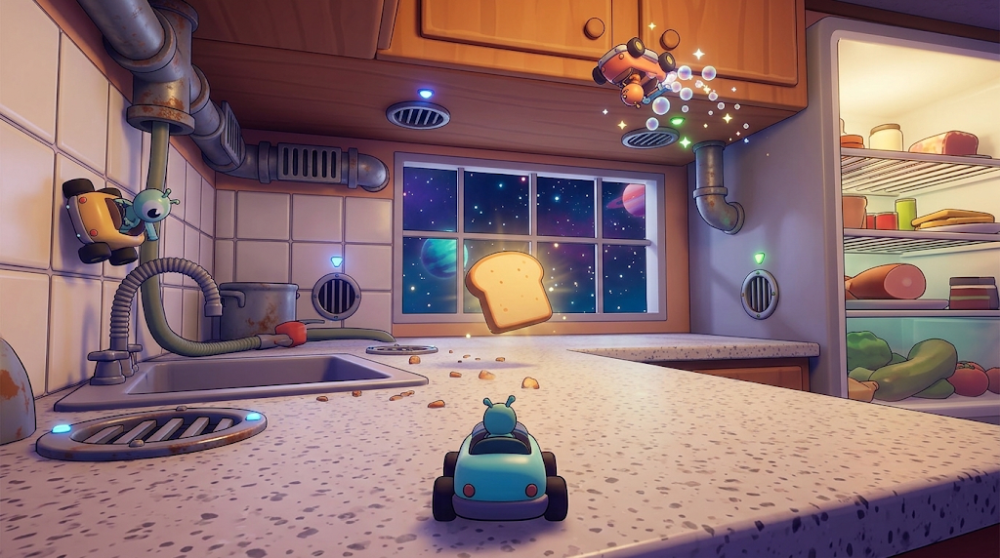
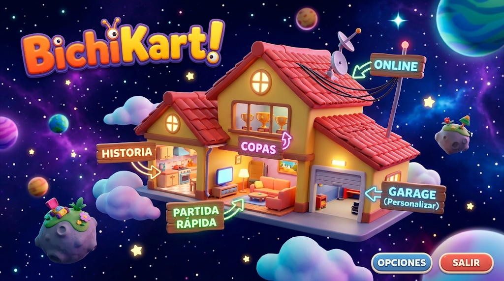
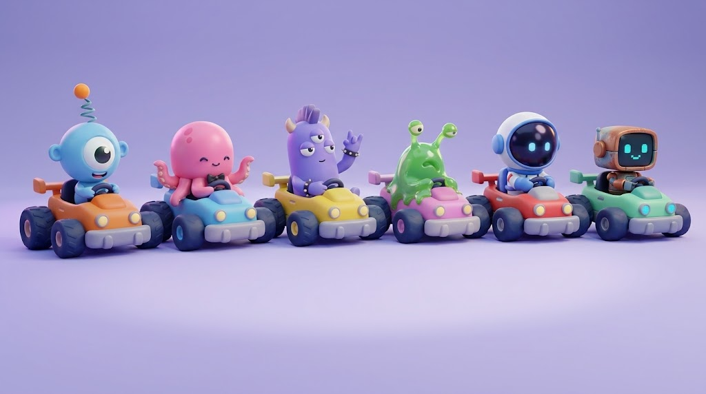

# BichiKart! — Documento de diseño

Juego de karts en 3D donde bichitos diminutos se pelean por una comida gigante dentro de una casa que flota en el espacio.

Este documento junta lo que se decidió hasta ahora. El prototipo jugable (etapa 2) está en construcción: el avance y cómo probarlo están en [`HISTORIAL.md`](HISTORIAL.md). Lo que falta definir está al final, en **Pendientes**.

*Boceto rápido de referencia, hecho con formas simples (no es Unity ni el arte final). Usa nombres de bichitos anteriores a los definitivos.*

## Datos generales

| Tema | Decisión |
|---|---|
| Nombre | **BichiKart!** |
| Motor | Unity 6.3 LTS (6000.3.14f1) |
| Plataformas | Primero PC (teclado y mouse, también joystick). Después celular |
| Tiendas | Steam, itch.io y Google Play |
| Estilo visual | Caricatura redondita (tipo Fall Guys o Mario Kart), con URP y sombreado caricatura. Se empieza con formas simples y el arte lindo viene después (ver **Arte y estilo**) |
| Mundo | Bichitos del tamaño de una hormiga dentro de una casa que flota en el espacio; por las ventanas se ven estrellas y planetas |
| Idiomas | Varios (español, inglés, portugués y más) |
| Modelo | Gratis, con compras estéticas (paquetes y pase de temporada). Nunca se vende algo que ayude a ganar |
| Equipo | Una persona programando en C#, con amigos que prueban |
| Ritmo | Sin apuro |

## Reglas

### La comida

- Al arrancar cada ronda, los karts salen de los extremos de la sala y la comida aparece en el medio.
- El primero que la toca la lleva arriba de su kart.
- Con la comida vas **más lento**; los demás van **más rápido**.
- Para robarla alcanza con **tocar** al que la tiene. El tiempo del nuevo dueño arranca de cero.
- El ladrón queda **protegido un segundito**, y al que le robaron sale **despedido** por el choque.
- La comida solo se **cae** (y queda suelta) si te pega un poder o si **dos jugadores te tocan a la vez**.
- Esconderse está permitido: los demás son más rápidos y ven al dueño en el minimapa.
- Los perseguidores **rebotan** entre ellos al chocarse.

### Tiempo para ganar (modo Clásico)

| Jugadores | Segundos por defecto |
|---|---|
| 2 | 15 |
| 3 | 20 (a confirmar) |
| 4 | 20 |

Se puede cambiar al crear la partida. La idea original contemplaba 25 segundos para más jugadores, pero el máximo quedó en 4.

- Las partidas son **al mejor de 3** rondas.
- **Muerte súbita:** si pasan 3 minutos sin ganador, el próximo que agarre la comida y aguante 5 segundos gana la ronda.

### Paredes, techo y gravedad

- Las ruedas son magnéticas: **subís manejando** por las paredes hasta el techo.
- El **botón de gravedad** te tira de golpe a la superficie **opuesta** (piso ↔ techo, pared ↔ pared de enfrente).
  - Tiene una **espera para recargarse**: 2,5 s para los perseguidores y **5 s para el que lleva la comida**, para que no se escape siempre así. Adentro de un caño no se recarga.
  - Mientras volás aparece una **marca del color de tu bichito donde vas a caer**, y en pantalla un aro muestra cuándo está lista.
- La **cámara gira con vos** cuando vas por paredes o techo. Hay una opción anti-mareo.

### Manejo

- Arcade con algo de peso: fácil de controlar, pero con inercia y técnica.
- Hay **salto**, **derrape** (con mini turbo al soltar), **freno y marcha atrás**, y **bocina**.
- El que lleva la comida también derrapa, pero su mini turbo empuja **solo un 30 %**.

### Tuberías

- Son **caños reales de la casa**, metálicos y grises: sifones y desagües, conductos de ventilación y mangueras. Nada de caños de colores tipo Mario.
- Las bocas son **rejillas o desagües redondos** en el piso, las paredes y el techo.
- Al lado de cada boca hay una **lucecita de color**. Las dos bocas de un mismo caño tienen el mismo color (azul, verde, rosa o amarillo), para saber por dónde vas a salir.
- Para meterte, parate sobre la boca y apretá **F (usar)**. Cuando te acercás, arriba de la boca aparece un **cartel-globito** con la F y el borde del color de la lucecita.
- Te metés por una boca y **viajás por adentro como en un tobogán**, con la cámara siguiéndote, hasta salir por otra boca.
- **Te pueden seguir y robar adentro** del caño.
- Sonido: succión al entrar y "plop" al salir.

### Ubicar al que tiene la comida

- **Flecha** en el borde de la pantalla que apunta al dueño.
- **Minimapa** abajo a la derecha, visto desde arriba: el ícono de cada kart cambia según esté en el piso, en una pared o en el techo.

### Tiempo de aguante en pantalla

- **Barra** inflada arriba, con la carita del dueño avanzando hacia la meta.
- **Aro** alrededor de la comida, arriba del kart, que se va llenando.

## Modos de juego

| Modo | Cómo se gana |
|---|---|
| **Clásico** | Aguantar la comida el tiempo de la tabla de arriba. Si te la roban, vuelve a cero |
| **Tiempo acumulado** | Cada uno suma su tiempo con la comida; gana el primero que llega a **60 segundos** |
| **Por equipos** (2 contra 2) | Suma el equipo que tiene la comida. Hay **botón de pase** para tirársela a un compañero; un rival puede interceptarla en el aire |

En equipos, cada uno mantiene su kart, pero lleva una **banderita y un aro de luz** del color del equipo.

### Al crear una partida se elige

- Modo.
- Cantidad de jugadores.
- Mapa, en versión **chica** (2 jugadores) o **grande** (3 o 4).
- Si hay **poderes** o no.

### Al ganar

- El bichito **se come la comida** y hace su **baile de victoria**.
- Al final de la partida hay **podio**.

## Un jugador (contra la compu)

- **Partida rápida:** elegís mapa, modo y hasta **3 rivales** de la compu.
- **Copas:** 4 mapas. El primero es de calentamiento sin eliminar (da ventaja de tiempo en la final); después vienen 3 de eliminación hasta la final 1 contra 1.
- **Modo historia:** en el planeta de los bichitos no hay comida y viajan a la casa espacial a buscar migas. Hay un capítulo por cuarto, en este orden: **Cocina → Baño → Cuarto de juguetes → Nave**.
  - **Jefe final, la aspiradora robot:** tiene la comida más grande de la casa. Hay que robársela y aguantar mientras te persigue aspirando.
- **Dificultad de la compu:** niveles fijos (Fácil, Normal, Difícil) y una opción automática que se adapta a cómo jugás. En el prototipo ya están los tres niveles fijos: se arranca en Normal y se cambian con las teclas 1, 2 y 3.
- **Para aprender:** un tutorial guiado y consejos en pantalla durante las primeras partidas.

## Online

| Tema | Decisión |
|---|---|
| Máximo de jugadores | 4 |
| Encontrar partida | Sala con código, partida rápida, lista de salas y amigos |
| Crossplay | Celular y PC juegan juntos |
| Comunicación | Emotes y stickers (sin chat de texto ni voz) |
| Si alguien se va | Lo reemplaza la compu; si vuelve, retoma |
| Servidores | El costo se decide más adelante |
| Cuentas | Steam o Google. El progreso de PC y el de celular quedan separados |

## Mapas

Cada mapa es una **sala cerrada** (piso, paredes y techo), no un circuito abierto, porque la gracia es pegarse a paredes y techo para escapar. Tiene versión chica y grande, y su comida típica.

| Mapa | Zonas | Comida | Ambientación |
|---|---|---|---|
| **Cocina** | Mesada y pileta, heladera abierta (piso helado), alacena, mesa con mantel | Rebanada de pan | Rincón cerrado de la cocina: el piso es la mesada de granito, el techo es la parte de abajo de la alacena y un costado es una heladera gigante abierta. Pared de azulejos con la pileta, ventana enorme al espacio y migas gigantes por el piso |
| **Baño** | Bañadera, lavatorio, inodoro (remolino al tirar la cadena), botiquín | Caramelo | Baldosas, chorros de agua, cepillo de dientes enorme; el caramelo sobre una esponja gigante |
| **Cuarto de juguetes** | Pista de autitos, castillo de bloques | Galletita | Bloques, dados y autitos de juguete; la galletita sobre una alfombra de juego |
| **Nave espacial** | Zonas sin gravedad, botón que da vuelta la gravedad de toda la sala, ventanal gigante | Comida espacial en tubo | Consolas gigantes, cables y compuertas; el tubo de comida sobre un soporte metálico |

*Concepto del mapa Cocina hecho con Gemini (versión aprobada). En el nivel real, el centro de la mesada queda despejado para manejar.*

Elementos vivos en los mapas:

- **Agua y gotas:** canilla que gotea, charcos, remolino del inodoro.
- **Cosas que empujan:** ventiladores, secador de pelo, juguete a cuerda.
- **Gravedad rara:** solo en la Nave.

## Poderes (opcionales)

- Salen de **cajitas** que aparecen en el mapa.
- Cualquiera puede agarrarlas, **incluso el que tiene la comida**.
- Se guarda **un poder por vez**.

| Poder | Qué hace |
|---|---|
| **Turbo de azúcar** | Pique de velocidad que además te deja subir paredes y techo más rápido |
| **Manteca resbalosa** | Dejás un charco; el primero que lo pisa patina y gira, y el charco desaparece |
| **Imán** | Durante 4 segundos podés robar desde el doble de distancia |
| **Nube de harina** | Te volvés invisible en el minimapa y en la flecha por unos segundos |

## Bichitos

Todos manejan igual: son solo de aspecto. Los nombres son alienígenas inventados. Cada uno tiene **bocina, baile, voz y reacciones propias**.

| Bichito | Cómo es | Personalidad | Disponible |
|---|---|---|---|
| **Blip** | Bolita celeste con un ojo gigante, orejitas y antena con pelotita | Hiperactivo: no para de moverse y habla rápido | Desde el principio |
| **Pulpi** | Pulpito rosa con cuatro tentáculos y moñito de concierto | Pianista: usa los tentáculos para todo a la vez | Desde el principio |
| **Zorbo** | Violeta de tres ojos con cuernitos, cresta y pulsera con tachas | Rockero: toca una guitarra invisible | Desde el principio |
| **Mukko** | Gota verde babosa con los ojos en dos antenitas | Pegote: se pega a todo y es muy cariñoso | Se desbloquea |
| **Kosmo** | Astronauta diminuto con casco enorme | Explorador serio: todo es una misión espacial | Se desbloquea |
| **Klank** | Mini robot oxidado con pantallita de cara | Ex pieza de la aspiradora robot que se escapó (conecta con la historia) | Se desbloquea |

- Mukko, Kosmo y Klank se desbloquean por historia, por desafío o con monedas, lo que llegue primero.
- Salen 6 bichitos y se suman más con las temporadas.

## Personalización

**Bichito**

- Color.
- Sombreros y accesorios: casco espacial, gorro de chef, colador de pasta, corona y anteojos de sol.
- Ojos y bocas.

**Kart**

- Colores de la carrocería (las ruedas son siempre negro azulado).
- Calcos: números y llamas, comida, espaciales y caras de bichitos.
- Detalles: alerón y bocina.
- Estelas: burbujas y estrellitas.

## Progreso y desbloqueos

- **Monedas:** se ganan jugando y compran lo común en la tienda.
- **Desafíos:** desbloquean lo especial. Hay permanentes, diarios, semanales y de temporada.
  - Tipos: de robo, de aguante, de gravedad y tuberías, y de colección.
- **Niveles de jugador:** con experiencia, hasta el **nivel 50**. Cada nivel da monedas, y algunos dan accesorios o calcos, marcos de perfil o títulos ("Ladrón de Migas", "Rey del Techo").
- **Plata real:** paquetes estéticos y pase de temporada. Nada que dé ventaja.

## Temporadas y eventos

- Temporadas de **2 a 3 meses**: **Navidad en órbita**, **Halloween**, **Verano** y **Lluvia de meteoritos**.
- **Pase de temporada** con camino gratis y premium.
- Eventos:
  - **Modos locos temporales:** comida gigante, todos en el techo, gravedad que cambia sola.
  - **Doble monedas.**
  - **Invasión de la aspiradora** en partidas normales.

## Cámara, controles e interfaz

### Cámara

- Detrás del kart. Con el mouse se gira **una vuelta entera (360°)** para mirar alrededor.
- **Vuelve sola** atrás del kart si dejás el mouse quieto 1,5 s **mientras manejás**; si estás quieto, queda donde la dejaste. El **clic de la ruedita** la centra enseguida.

### PC (teclado y mouse)

| Tecla | Acción |
|---|---|
| W | Acelerar |
| S | Frenar y marcha atrás |
| A / D | Doblar |
| Espacio | Saltar |
| Shift | Derrapar |
| Ctrl | Cambiar la gravedad |
| E | Usar el poder |
| F | Usar (meterse en un caño) |
| Q | Bocina |
| R | Pasar la comida (equipos) |
| T (mantener) | Rueda de emotes y stickers |
| Mouse | Girar la cámara |
| Clic de la ruedita | Centrar la cámara |

### Joystick en PC

- Sí, con iconos de botones según el control.

### Celular (más adelante)

- Palanca virtual a la izquierda.
- Botones a la derecha: acelerar, saltar y gravedad.
- Deslizando el dedo se mueve la cámara.

### Emotes y stickers

- **Emotes:** reírse, enojarse, saludar, llorar.
- **Stickers:** "¡Vení acá!", "¡Te la robo!", "¡Buena!", "¡Ups!".

### Menú principal

La casa vista desde afuera, flotando en el espacio. La cámara la rodea despacio y, al elegir una opción, viaja hasta ese cuarto con un movimiento de cine. Cada cuarto es un modo:

- Cocina: historia.
- Living: partida rápida.
- Garaje: personalizar.
- Antena del techo: online.
- Ventana con trofeos: copas.
- Botones de Opciones y Salir abajo a la derecha.

*Concepto del menú principal hecho con Gemini.*

### Repeticiones

- Se ven al final de la partida, con cámaras libres y cámara lenta, y se pueden guardar.

### Accesibilidad

- Anti-mareo (suavizar el giro de cámara y el temblor).
- Modo para daltonismo.
- Teclas a gusto.
- Subtítulos.

## Arte y estilo

Propuesta hecha con Gemini, ajustada a lo decidido.

### Cómo lograr el estilo en Unity 6

- **URP** (Universal Render Pipeline): liviano para celular e ideal para este estilo.
- **Sombreado caricatura** (toon) con un **contorno** fino, para que los karts diminutos resalten contra los muebles gigantes.
- **Formas biseladas:** nada de esquinas filosas. Para el prototipo, ProBuilder alcanza para redondear formas.
- **Iluminación:** luz cálida (amarillos y naranjas) adentro de la casa, contra la luz fría azul y violeta del espacio que entra por las ventanas.
- **Oclusión ambiental** en el postprocesado, para que todo se vea bien apoyado en pisos y paredes.

### Paleta

- Colores muy saturados con base pastel: azul eléctrico, rosa chicle, verde menta, naranja vibrante.
- Sin negros puros ni grises oscuros: las sombras y las partes mecánicas van en azul noche o violeta muy oscuro.

### Bichitos

Todos se arman con esferas, cápsulas y formas orgánicas simples.

*Concepto de los bichitos hecho con Gemini (versión corregida).*

| Bichito | Forma | Cómo va en el kart | Kart por defecto |
|---|---|---|---|
| **Blip** | Bolita celeste claro con un ojo central enorme, dos orejitas redondas y una antena de resorte con bolita naranja que vibra al acelerar | En el centro, agarrando el volante con energía y rebotando | Naranja |
| **Pulpi** | Cúpula rosa con cuatro tentáculos cortos, boquita chiquita y moñito negro de concierto | Dos tentáculos en el volante y dos tocando un piano invisible en el aire | Celeste |
| **Zorbo** | Cápsula violeta con tres ojos en fila, dos cuernitos, cresta y pulsera con tachas | Tirado hacia atrás, con una mano en el volante y haciendo cuernitos con la otra | Amarillo |
| **Mukko** | Gota verde traslúcida y viscosa, con los ojos en dos antenas flexibles que se mueven con la inercia | Desparramado sobre el kart, con manitos de baba pegadas al volante | Rosa |
| **Kosmo** | Cápsula blanca de traje espacial con un casco esférico enorme; adentro solo se ven dos ojitos brillantes | Recto y formal, con las dos manos enguantadas en el volante | Rojo |
| **Klank** | Cajita de metal cobre oxidado con esquinas redondeadas y una pantallita con ojos y boca de píxeles celestes | Rígido, con movimientos a los saltos | Verde menta |

- Cada kart por defecto contrasta con su bichito, para que se lean bien de lejos.
- Blip se cambió de verde a celeste y se le agregaron orejitas para que no se parezca a Mike Wazowski (Monsters Inc.).

### Karts

- **Chasis:** bloque de plástico grueso y compacto, con paragolpes redondeado gris claro o metálico.
- **Motor:** chiquito, atrás, con escapes grandes.
- **Ruedas:** goma negro azulado, anchas.
- **Alerón:** de juguete, con bordes de goma, que vibra con la velocidad.
- **Detalles cómicos:** antenas con resorte, alerones dobles, escapes desproporcionados.
- **Calcos:** grandes y simples, para distinguirse de lejos.
- **Estelas:** burbujas transparentes de colores y estrellitas o chispas.

### Interfaz

- Botones y paneles con volumen, como inflados o de plástico, sin tapar la acción.
- La flecha al dueño de la comida es 3D, de color vivo con borde blanco.
- El minimapa tiene un estilo holográfico de juguete, con las caritas de los bichitos y la comida titilando.
- El logo de **BichiKart!** es naranja, con ojitos y antenas (ver el concepto del menú).

## Sonido y música

- **Música:** funk espacial. Se pone tensa en los últimos segundos de aguante y suma un instrumento cuando vos tenés la comida.
- **Voces:** idioma inventado con balbuceo suave, distinto para cada bichito.
- **Robo:** "plop" para el ladrón y grito ofendido del robado.
- **Tuberías:** succión al entrar, "plop" al salir.

## Notas técnicas

Cómo se resuelve cada parte difícil en Unity. Sale de la revisión técnica de Gemini y se ajusta en el prototipo.

| Parte | Cómo se hace |
|---|---|
| **Kart** | No se usan las ruedas de física de Unity (WheelColliders), porque siempre tiran hacia abajo del mundo. El kart físico es una **esfera invisible** con Rigidbody y sin la gravedad de Unity: el juego le aplica su propia gravedad hacia la superficie que tiene abajo, que detecta con un rayo. El kart que se ve va aparte, copia la posición de la esfera y se inclina en el derrape |
| **Cámara** | **Cinemachine 3**, atada al "arriba" del kart para que gire con vos en paredes y techo. Para el anti-mareo, además de suavizar el giro, se prueba dejar el horizonte fijo |
| **Tuberías** | Paquete **Unity Splines**. Al entrar, el kart sigue la curva del caño a velocidad pareja y puede girar alrededor de las paredes del tubo para esquivar o chocar al de adelante |
| **Compu** | El NavMesh de Unity no sirve para paredes y techo. Se usa una **red de puntos de paso** en piso, paredes y techo, y rayos cortos alrededor de cada kart para esquivar, buscar cajitas o perseguir al dueño de la comida |

### Preparado para el online

El prototipo es sin red, pero se arma para que sumarla después no obligue a reescribir todo:

- Cada kart recibe sus **órdenes** (acelerar, frenar, doblar, saltar, derrapar, gravedad y bocina) de una **fuente intercambiable**: tu teclado, la compu o, más adelante, la red.
- Las **reglas** (agarrar, aguantar, robar, protección y tiempo) viven en un solo lugar: el **árbitro de la partida**.
- Para el online se elige entre **Netcode for GameObjects** y **FishNet**, con **Unity Relay** y **Lobby** para las salas. Como los karts usan física, jugar por internet necesita predecir y corregir el movimiento en cada PC, y eso se prueba temprano.

## Etapas de trabajo

1. **Documento de diseño** (este archivo).
2. **Prototipo jugable contra la compu**, con formas simples: un mapa, manejo por paredes y techo, gravedad, tuberías y robo de comida. Sin online, pero preparado para sumarlo (ver **Notas técnicas**). Sirve para comprobar que sea divertido.
3. **Prueba de online**: dos PCs en la misma sala, con la comida y el robo, para confirmar que funciona por internet antes de invertir en arte.
4. **Bichitos, mapas y arte.**
5. **Online completo y partidas personalizadas.**

Antes de cada etapa se revisa y se aprueba qué se va a hacer.

## Pendientes

- **Imágenes de concepto** del Baño, el Cuarto de juguetes, la Nave y el kart para personalizar (con Gemini).
- **Controles:** botones del joystick y detalle de los controles de celular.
- **Desafíos:** lista concreta y sus premios.
- **Tutorial:** contenido paso a paso.
- **Copas:** nombres y qué mapas tiene cada una.
- **Temporadas:** mapas, bichitos y comidas de cada una.
- **Accesorios, calcos y estelas:** lista completa y cuáles están disponibles al empezar.
- **Precios:** monedas por partida, precios en la tienda y de los paquetes.
- **Online:** librería de red (Netcode for GameObjects o FishNet), servicio de servidores y su costo.

## Referencias

- La rama `bichikarts-2d-referencia` tiene un primer prototipo en 2D. No es este juego, pero se guarda por si sirve para otro.
