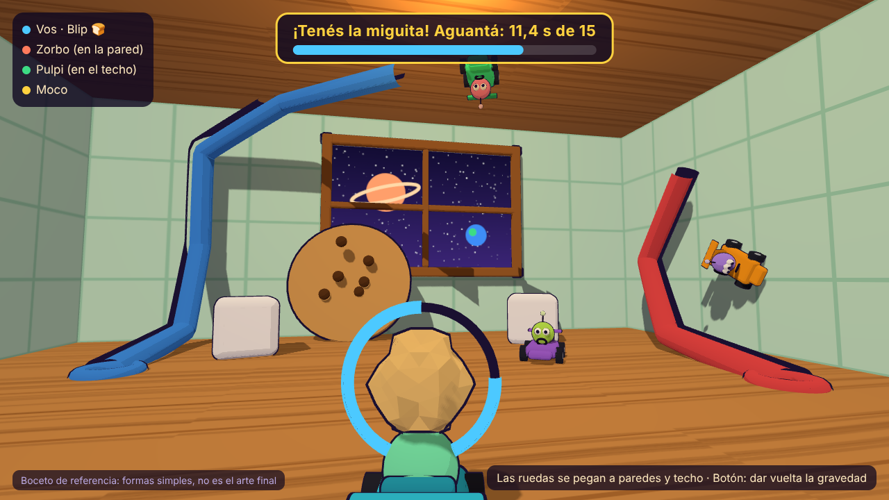

# BichiKart! — Documento de diseño

Juego de karts en 3D donde bichitos diminutos se pelean por una comida gigante dentro de una casa que flota en el espacio.

Este documento junta lo que se decidió hasta ahora. Todavía no hay nada programado del juego 3D. Lo que falta definir está al final, en **Pendientes**.

*Boceto rápido de referencia, hecho con formas simples (no es Unity ni el arte final). Usa nombres de bichitos anteriores a los definitivos.*

## Datos generales

| Tema | Decisión |
|---|---|
| Nombre | **BichiKart!** |
| Motor | Unity 6 |
| Plataformas | Primero PC (teclado y mouse, también joystick). Después celular |
| Tiendas | Steam, itch.io y Google Play |
| Estilo visual | Caricatura redondita (tipo Fall Guys o Mario Kart). Se empieza con formas simples y el arte lindo viene después |
| Mundo | Bichitos del tamaño de una hormiga dentro de una casa que flota en el espacio; por las ventanas se ven estrellas y planetas |
| Idiomas | Varios (español, inglés, portugués y más) |
| Modelo | Gratis, con compras estéticas (paquetes y pase de temporada). Nunca se vende algo que ayude a ganar |
| Equipo | Una persona programando en C#, con amigos que prueban |
| Ritmo | Sin apuro |

## Reglas

### La comida

- Al arrancar cada ronda, los karts salen de los extremos de la sala y la comida aparece en el medio.
- El primero que la toca la lleva arriba de su kart.
- Con la comida vas **más lento**; los demás van **más rápido**.
- Para robarla alcanza con **tocar** al que la tiene. El tiempo del nuevo dueño arranca de cero.
- El ladrón queda **protegido un segundito**, y al que le robaron sale **despedido** por el choque.
- La comida solo se **cae** (y queda suelta) si te pega un poder o si **dos jugadores te tocan a la vez**.
- Esconderse está permitido: los demás son más rápidos y ven al dueño en el minimapa.
- Los perseguidores **rebotan** entre ellos al chocarse.

### Tiempo para ganar (modo Clásico)

| Jugadores | Segundos por defecto |
|---|---|
| 2 | 15 |
| 3 | 20 (a confirmar) |
| 4 | 20 |

Se puede cambiar al crear la partida. La idea original contemplaba 25 segundos para más jugadores, pero el máximo quedó en 4.

- Las partidas son **al mejor de 3** rondas.
- **Muerte súbita:** si pasan 3 minutos sin ganador, el próximo que agarre la comida y aguante 5 segundos gana la ronda.

### Paredes, techo y gravedad

- Las ruedas son magnéticas: **subís manejando** por las paredes hasta el techo.
- El **botón de gravedad** te tira de golpe a la superficie **opuesta** (piso ↔ techo, pared ↔ pared de enfrente).
- La **cámara gira con vos** cuando vas por paredes o techo. Hay una opción anti-mareo.

### Manejo

- Arcade con algo de peso: fácil de controlar, pero con inercia y técnica.
- Hay **salto**, **derrape** (con mini turbo al soltar), **freno y marcha atrás**, y **bocina**.

### Tuberías

- Te metés por una boca y **viajás por adentro como en un tobogán**, con la cámara siguiéndote, hasta salir por otra boca.
- **Te pueden seguir y robar adentro** del caño.
- Sonido: succión al entrar y "plop" al salir.

### Ubicar al que tiene la comida

- **Flecha** en el borde de la pantalla que apunta al dueño.
- **Minimapa** abajo a la derecha.

## Modos de juego

| Modo | Cómo se gana |
|---|---|
| **Clásico** | Aguantar la comida el tiempo de la tabla de arriba. Si te la roban, vuelve a cero |
| **Tiempo acumulado** | Cada uno suma su tiempo con la comida; gana el primero que llega a **60 segundos** |
| **Por equipos** (2 contra 2) | Suma el equipo que tiene la comida. Hay **botón de pase** para tirársela a un compañero; un rival puede interceptarla en el aire |

En equipos, cada uno mantiene su kart, pero lleva una **banderita y un aro de luz** del color del equipo.

### Al crear una partida se elige

- Modo.
- Cantidad de jugadores.
- Mapa, en versión **chica** (2 jugadores) o **grande** (3 o 4).
- Si hay **poderes** o no.

### Al ganar

- El bichito **se come la comida** y hace su **baile de victoria**.
- Al final de la partida hay **podio**.

## Un jugador (contra la compu)

- **Partida rápida:** elegís mapa, modo y hasta **3 rivales** de la compu.
- **Copas:** 4 mapas. El primero es de calentamiento sin eliminar (da ventaja de tiempo en la final); después vienen 3 de eliminación hasta la final 1 contra 1.
- **Modo historia:** en el planeta de los bichitos no hay comida y viajan a la casa espacial a buscar migas. Hay un capítulo por cuarto, en este orden: **Cocina → Baño → Cuarto de juguetes → Nave**.
  - **Jefe final, la aspiradora robot:** tiene la comida más grande de la casa. Hay que robársela y aguantar mientras te persigue aspirando.
- **Dificultad de la compu:** niveles fijos (Fácil, Normal, Difícil) y una opción automática que se adapta a cómo jugás.
- **Para aprender:** un tutorial guiado y consejos en pantalla durante las primeras partidas.

## Online

| Tema | Decisión |
|---|---|
| Máximo de jugadores | 4 |
| Encontrar partida | Sala con código, partida rápida, lista de salas y amigos |
| Crossplay | Celular y PC juegan juntos |
| Comunicación | Emotes y stickers (sin chat de texto ni voz) |
| Si alguien se va | Lo reemplaza la compu; si vuelve, retoma |
| Servidores | El costo se decide más adelante |
| Cuentas | Steam o Google. El progreso de PC y el de celular quedan separados |

## Mapas

Cada mapa tiene versión chica y grande, con su comida típica.

| Mapa | Zonas | Comida |
|---|---|---|
| **Cocina** | Mesada y pileta, heladera abierta (piso helado), alacena, mesa con mantel | Miguita de pan |
| **Baño** | Bañadera, lavatorio, inodoro (remolino al tirar la cadena), botiquín | Caramelo |
| **Cuarto de juguetes** | Pista de autitos, castillo de bloques | Galletita |
| **Nave espacial** | Zonas sin gravedad, botón que da vuelta la gravedad de toda la sala, ventanal gigante | Comida espacial en tubo |

Elementos vivos en los mapas:

- **Agua y gotas:** canilla que gotea, charcos, remolino del inodoro.
- **Cosas que empujan:** ventiladores, secador de pelo, juguete a cuerda.
- **Gravedad rara:** solo en la Nave.

## Poderes (opcionales)

- Salen de **cajitas** que aparecen en el mapa.
- Cualquiera puede agarrarlas, **incluso el que tiene la comida**.
- Se guarda **un poder por vez**.

| Poder | Qué hace |
|---|---|
| **Turbo de azúcar** | Pique de velocidad que además te deja subir paredes y techo más rápido |
| **Manteca resbalosa** | Dejás un charco; el primero que lo pisa patina y gira, y el charco desaparece |
| **Imán** | Durante 4 segundos podés robar desde el doble de distancia |
| **Nube de harina** | Te volvés invisible en el minimapa y en la flecha por unos segundos |

## Bichitos

Todos manejan igual: son solo de aspecto. Los nombres son alienígenas inventados. Cada uno tiene **bocina, baile, voz y reacciones propias**.

| Bichito | Cómo es | Personalidad | Disponible |
|---|---|---|---|
| **Blip** | Bolita verde menta con un ojo gigante y antena con pelotita | Hiperactivo: no para de moverse y habla rápido | Desde el principio |
| **Pulpi** | Pulpito rosa con cuatro tentáculos | Pianista: usa los tentáculos para todo a la vez | Desde el principio |
| **Zorbo** | Violeta de tres ojos con cuernitos | Rockero: toca una guitarra invisible | Desde el principio |
| **Mukko** | Gota verde babosa con los ojos en dos antenitas | Pegote: se pega a todo y es muy cariñoso | Se desbloquea |
| **Kosmo** | Astronauta diminuto con casco enorme | Explorador serio: todo es una misión espacial | Se desbloquea |
| **Klank** | Mini robot oxidado con pantallita de cara | Ex pieza de la aspiradora robot que se escapó (conecta con la historia) | Se desbloquea |

- Mukko, Kosmo y Klank se desbloquean por historia, por desafío o con monedas, lo que llegue primero.
- Salen 6 bichitos y se suman más con las temporadas.

## Personalización

**Bichito**

- Color.
- Sombreros y accesorios: casco espacial, gorro de chef, colador de pasta, corona y anteojos de sol.
- Ojos y bocas.

**Kart**

- Colores (las ruedas siempre son negras).
- Calcos: números y llamas, comida, espaciales y caras de bichitos.
- Detalles: alerón y bocina.
- Estelas: burbujas y estrellitas.

## Progreso y desbloqueos

- **Monedas:** se ganan jugando y compran lo común en la tienda.
- **Desafíos:** desbloquean lo especial. Hay permanentes, diarios, semanales y de temporada.
  - Tipos: de robo, de aguante, de gravedad y tuberías, y de colección.
- **Niveles de jugador:** con experiencia, hasta el **nivel 50**. Cada nivel da monedas, y algunos dan accesorios o calcos, marcos de perfil o títulos ("Ladrón de Migas", "Rey del Techo").
- **Plata real:** paquetes estéticos y pase de temporada. Nada que dé ventaja.

## Temporadas y eventos

- Temporadas de **2 a 3 meses**: **Navidad en órbita**, **Halloween**, **Verano** y **Lluvia de meteoritos**.
- **Pase de temporada** con camino gratis y premium.
- Eventos:
  - **Modos locos temporales:** comida gigante, todos en el techo, gravedad que cambia sola.
  - **Doble monedas.**
  - **Invasión de la aspiradora** en partidas normales.

## Cámara, controles e interfaz

### Cámara

- Detrás del kart. Con el mouse se gira para mirar alrededor y **vuelve sola** atrás del kart al soltarlo.

### PC (teclado y mouse)

| Tecla | Acción |
|---|---|
| W | Acelerar |
| S | Frenar y marcha atrás |
| A / D | Doblar |
| Espacio | Saltar |
| Shift | Derrapar |
| Ctrl | Cambiar la gravedad |
| E | Usar el poder |
| Q | Bocina |
| R | Pasar la comida (equipos) |
| T (mantener) | Rueda de emotes y stickers |
| Mouse | Girar la cámara |

### Joystick en PC

- Sí, con iconos de botones según el control.

### Celular (más adelante)

- Palanca virtual a la izquierda.
- Botones a la derecha: acelerar, saltar y gravedad.
- Deslizando el dedo se mueve la cámara.

### Emotes y stickers

- **Emotes:** reírse, enojarse, saludar, llorar.
- **Stickers:** "¡Vení acá!", "¡Te la robo!", "¡Buena!", "¡Ups!".

### Menú principal

La casa vista desde afuera, flotando en el espacio. Cada cuarto es un modo:

- Cocina: historia.
- Living: partida rápida.
- Garaje: personalizar.
- Antena del techo: online.
- Ventana con trofeos: copas.

### Repeticiones

- Se ven al final de la partida, con cámaras libres y cámara lenta, y se pueden guardar.

### Accesibilidad

- Anti-mareo (suavizar el giro de cámara y el temblor).
- Modo para daltonismo.
- Teclas a gusto.
- Subtítulos.

## Sonido y música

- **Música:** funk espacial. Se pone tensa en los últimos segundos de aguante y suma un instrumento cuando vos tenés la comida.
- **Voces:** idioma inventado con balbuceo suave, distinto para cada bichito.
- **Robo:** "plop" para el ladrón y grito ofendido del robado.
- **Tuberías:** succión al entrar, "plop" al salir.

## Etapas de trabajo

1. **Documento de diseño** (este archivo).
2. **Prototipo jugable contra la compu**, con formas simples: un mapa, manejo por paredes y techo, gravedad, tuberías y robo de comida. Sirve para comprobar que sea divertido.
3. **Bichitos, mapas y arte.**
4. **Online y partidas personalizadas.**

Antes de cada etapa se revisa y se aprueba qué se va a hacer.

## Pendientes

- **Diseño visual** (se está consultando aparte).
- **Controles:** botones del joystick y detalle de los controles de celular.
- **Desafíos:** lista concreta y sus premios.
- **Tutorial:** contenido paso a paso.
- **Copas:** nombres y qué mapas tiene cada una.
- **Temporadas:** mapas, bichitos y comidas de cada una.
- **Accesorios, calcos y estelas:** lista completa y cuáles están disponibles al empezar.
- **Precios:** monedas por partida, precios en la tienda y de los paquetes.
- **Online:** servicio de servidores (por ejemplo Unity Gaming Services o Photon) y su costo.

## Referencias

- La rama `bichikarts-2d-referencia` tiene un primer prototipo en 2D. No es este juego, pero se guarda por si sirve para otro.
